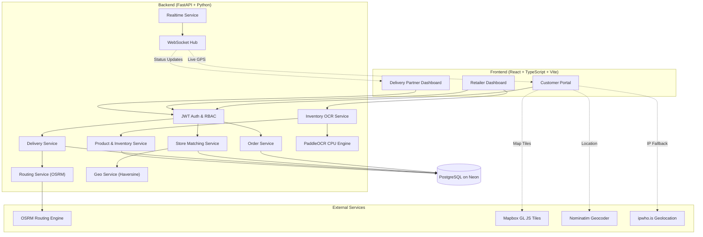
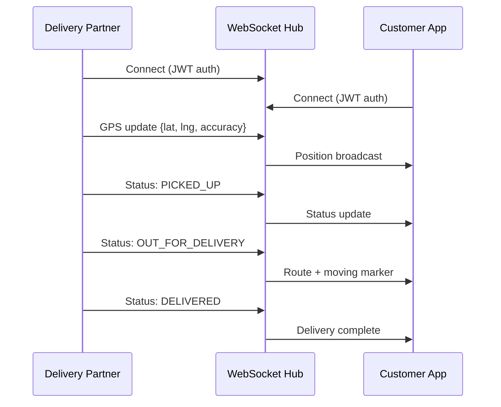

<div align="center">

# 🛒 Dukaan2Door

### Hyperlocal Direct Delivery Platform for Local Retailers

_From neighbourhood store to your doorstep — in minutes._

Customer ordering · Inventory-aware store matching · Retailer fulfillment  
Delivery partner self-claim · OSRM route planning · Real-time live tracking

[](backend/)
[](frontend/)
[](https://neon.tech/)
[](https://docs.mapbox.com/mapbox-gl-js/)
[](https://project-osrm.org/)
[](https://github.com/PaddlePaddle/PaddleOCR)
[](backend/alembic/)
[](#testing)
[](#real-time-tracking)

</div>

---

## Table of Contents

- [Overview](#overview)
- [Core Workflow](#core-workflow)
- [System Architecture](#system-architecture)
- [Technology Stack](#technology-stack)
- [Project Structure](#project-structure)
- [Features by Portal](#features-by-portal)
  - [Customer Portal](#-customer-portal)
  - [Retailer Portal](#-retailer-portal)
  - [Delivery Partner Portal](#-delivery-partner-portal)
- [Backend Services](#backend-services)
- [Real-Time Tracking](#real-time-tracking)
- [Data Architecture](#data-architecture)
- [Local Setup](#local-setup)
- [Environment Variables](#environment-variables)
- [Inventory Image Onboarding](#inventory-image-onboarding)
- [Demo Credentials & Walkthrough](#demo-credentials--walkthrough)
- [Testing](#testing)
- [Scripts](#scripts)
- [Deployment](#deployment)
- [Documentation](#documentation)

---

## Overview

**Dukaan2Door** is a hyperlocal grocery and essentials delivery platform that
connects customers with nearby local retailers. A customer selects products,
shares a delivery location, and places an order. The backend selects an eligible
store using distance and inventory checks, while retailer and delivery partner
workflows move the order through fulfillment to delivery — all tracked in real
time on an interactive map.

The platform is designed around a **direct local-store experience** rather than
a large marketplace. It features three dedicated portals — one each for
customers, retailers, and delivery partners — unified by a single login page
with role-based routing.

### Key Highlights

- **Inventory-aware store matching** — 2 km radius, 5 km fallback
- **Complete order lifecycle** — from cart to delivered, with state-machine validation
- **Live delivery tracking** — WebSocket-driven GPS updates on Mapbox GL JS maps
- **AI-assisted inventory** — local PaddleOCR bill/photo extraction with mandatory retailer review
- **OSRM route planning** — real road-network routes with ETA estimation
- **Three full dashboards** — Customer, Retailer, and Delivery Partner
- **Auto-location detection** — HTML5 GPS → IP geolocation → Nominatim fallback chain

---

## Core Workflow

```
┌──────────────────────────────────────────────────────────────────┐
│  CUSTOMER                                                        │
│  📍 Location detection  →  🛍️ Browse & search products           │
│  🛒 Add to cart         →  💳 Checkout with delivery address      │
│  📦 Place order         →  📊 Track order status in real time     │
└──────────────┬───────────────────────────────────────────────────┘
               │
               ▼
┌──────────────────────────────────────────────────────────────────┐
│  BACKEND                                                         │
│  🏪 Match store (2km → 5km)  →  📦 Lock & decrement inventory   │
│  ✅ Validate order            →  🔔 Notify retailer              │
└──────────────┬───────────────────────────────────────────────────┘
               │
               ▼
┌──────────────────────────────────────────────────────────────────┐
│  RETAILER                                                        │
│  📋 View incoming order  →  ✅ Accept order                      │
│  👨‍🍳 Prepare order       →  📦 Mark ready for pickup             │
│  📷 Scan and review stock separately with PaddleOCR               │
└──────────────┬───────────────────────────────────────────────────┘
               │
               ▼
┌──────────────────────────────────────────────────────────────────┐
│  DELIVERY PARTNER                                                │
│  📋 View nearby order    →  ✅ Atomically claim delivery         │
│  🏪 Pick up from store   →  🛵 Start delivery route              │
│  📍 Broadcast live GPS   →  ✅ Mark delivered                     │
└──────────────────────────────────────────────────────────────────┘
```

**Order Lifecycle State Machine:**

```
RECEIVED → ACCEPTED → PREPARING → READY_FOR_PICKUP → ASSIGNED
         → PICKED_UP → OUT_FOR_DELIVERY → DELIVERED
```

---

## System Architecture



---

## Technology Stack

| Layer | Technology |
|---|---|
| **Frontend Framework** | React 18, TypeScript, Vite |
| **Styling** | Tailwind CSS, Lucide Icons |
| **Maps & Geo** | Mapbox GL JS, GeoJSON route layers, browser geolocation |
| **State Management** | React Context API |
| **Backend API** | Python 3.11-3.13, FastAPI, Pydantic v2 |
| **Database** | PostgreSQL on [Neon](https://neon.tech/), SQLAlchemy ORM |
| **Migrations** | Alembic |
| **Authentication** | JWT tokens, bcrypt password hashing, role-based authorization |
| **Routing Engine** | OSRM (Open Source Routing Machine) |
| **Inventory OCR** | PaddleOCR 3.7.0 + PaddlePaddle 3.3.1, CPU-only, provider-neutral service |
| **Geocoding** | Nominatim (reverse), ipwho.is (IP fallback) |
| **Real-time** | FastAPI WebSockets, in-memory connection manager |
| **Deployment** | Render web service + Neon PostgreSQL |

---

## Project Structure

```
Dukaan2Door/
├── backend/
│   ├── alembic/                    # Database migrations
│   ├── app/
│   │   ├── api/v1/endpoints/       # REST API endpoints
│   │   │   ├── auth.py             # Login, register, token refresh
│   │   │   ├── orders.py           # Order CRUD, status tracking
│   │   │   ├── deliveries.py       # Delivery assignment & tracking
│   │   │   ├── products.py         # Product catalog & inventory
│   │   │   ├── inventory.py        # OCR analysis, review confirmation, history
│   │   │   ├── retailers.py        # Store management
│   │   │   ├── customers.py        # Customer profiles
│   │   │   ├── delivery_partners.py # Partner profiles & availability
│   │   │   ├── matching.py         # Store matching endpoint
│   │   │   ├── uploads.py          # File uploads
│   │   │   └── websocket.py        # WebSocket connections
│   │   ├── core/                   # Config, security, dependencies
│   │   ├── models/                 # SQLAlchemy ORM models
│   │   ├── schemas/                # Pydantic request/response schemas
│   │   ├── services/               # Business logic layer
│   │   │   ├── auth_service.py
│   │   │   ├── order_service.py
│   │   │   ├── delivery_service.py
│   │   │   ├── store_matching_service.py
│   │   │   ├── routing_service.py
│   │   │   ├── geo_service.py
│   │   │   ├── product_service.py
│   │   │   ├── ocr_service.py
│   │   │   ├── inventory_image_analyzer.py
│   │   │   ├── inventory_parser.py
│   │   │   └── realtime_service.py
│   │   └── main.py                 # FastAPI app entry
│   ├── tests/                      # Pytest unit and integration suite
│   └── requirements.txt
├── frontend/
│   ├── src/
│   │   ├── components/
│   │   │   ├── customer/           # ProductCard, CartItem, OrderTimeline, LocationModal...
│   │   │   ├── retailer/           # OrderCard, OrderDetailModal, ProductModal, StoreToggle...
│   │   │   ├── delivery/           # ActiveDeliveryCard, StatusControls, LocationTracker...
│   │   │   ├── maps/               # MapView, DeliveryMap, StoreLocationPicker, RadiusMap
│   │   │   ├── layout/             # Shared layout components
│   │   │   └── ui/                 # Reusable UI primitives
│   │   ├── pages/
│   │   │   ├── auth/               # Unified login page
│   │   │   ├── customer/           # 17 pages (Home, Cart, Checkout, Tracking, Orders...)
│   │   │   ├── retailer/           # 10 pages (Dashboard, Orders, Inventory, Store...)
│   │   │   └── delivery/           # 7 pages (Dashboard, Available, Current, Earnings...)
│   │   ├── services/               # API client and service layer
│   │   ├── context/                # Auth & Cart context providers
│   │   ├── types/                  # TypeScript interfaces
│   │   └── App.tsx                 # Router with role-based routing
│   └── package.json
├── scripts/                        # Seeding, ingestion, and E2E story scripts
├── data/                           # Dataset assets and staging
├── docs/                           # Architecture and testing documentation
└── README.md
```

---

## Features by Portal

### 🛍️ Customer Portal

| Feature | Description |
|---|---|
| **Location Detection** | Auto-detect via HTML5 GPS → IP geolocation → manual address entry |
| **Interactive Map** | Mapbox GL JS location selection with responsive controls and markers |
| **Product Browsing** | Category filtering, search, availability badges |
| **Store Discovery** | View nearby stores on map with radius overlay |
| **Cart Management** | Add/remove items, quantity selector, running total |
| **Checkout** | Delivery address confirmation, order placement |
| **Order Tracking** | Real-time status timeline with step-by-step progress |
| **Live Map Tracking** | Watch delivery partner move on map in real time |
| **Order History** | Past orders with detail view and status |
| **Profile Management** | Update name, phone, delivery address |

**Customer Pages:** `HomePage`, `LocationPage`, `StorePage`, `ProductListingPage`, `ProductDetailPage`, `SearchPage`, `CartPage`, `CheckoutPage`, `OrderConfirmationPage`, `OrderStatusPage`, `OrderDetailPage`, `OrderHistoryPage`, `LiveTrackingPage`, `ProfilePage`, `NotificationsPage`, `HelpSupportPage`, `RegisterPage`

---

### 🏪 Retailer Portal

| Feature | Description |
|---|---|
| **Dashboard** | Order overview with status filters and quick actions |
| **Order Management** | Accept, prepare, and mark orders ready for pickup |
| **Delivery Dispatch** | Make ready orders available to eligible nearby delivery partners |
| **Inventory Management** | Scan a bill/photo into editable drafts, add manually, review before confirmation, update store-scoped stock, and toggle availability |
| **Store Settings** | Business hours, store status toggle (open/closed) |
| **Performance Analytics** | Order volume, revenue, and fulfillment metrics |
| **Store Overview** | Map-based store location with delivery radius visualization |

**Retailer Pages:** `RetailerHomePage`, `RetailerDashboard`, `RetailerOrdersPage`, `RetailerInventoryPage`, `RetailerStorePage`, `RetailerStoreOverviewPage`, `RetailerMenuPage`, `RetailerPerformancePage`, `RetailerBusinessSettingsPage`, `RetailerHelpPage`

---

### 🚴 Delivery Partner Portal

| Feature | Description |
|---|---|
| **Dashboard** | Active delivery with status controls, earnings summary |
| **Available Orders** | Browse and claim orders ready for pickup |
| **Active Delivery** | Step-by-step delivery flow with map and route |
| **GPS Broadcasting** | Browser GPS or road-based demo updates broadcast to the customer via WebSocket |
| **Status Progression** | Accept → Pick Up → Out for Delivery → Delivered |
| **Earnings Tracker** | Delivery history with earnings breakdown |
| **Profile** | Availability toggle, vehicle info, contact details |

**Delivery Pages:** `DeliveryHomePage`, `DeliveryDashboard`, `AvailableOrdersPage`, `CurrentDeliveryPage`, `DeliveryHistoryPage`, `DeliveryEarningsPage`, `DeliveryProfilePage`

---

## Backend Services

| Service | File | Responsibility |
|---|---|---|
| **Auth** | `auth_service.py` | JWT token generation, password hashing, user validation |
| **Store Matching** | `store_matching_service.py` | 2 km/5 km radius search, inventory-aware store selection |
| **Orders** | `order_service.py` | Order creation, status transitions, ownership validation |
| **Delivery** | `delivery_service.py` | Eligible-order discovery, atomic rider claims/rejections, delivery state machine |
| **Routing** | `routing_service.py` | OSRM integration for road-network routes, distance, and ETA |
| **Geo** | `geo_service.py` | Haversine distance calculation, coordinate validation |
| **Products** | `product_service.py` | Catalog queries, category filtering, inventory checks |
| **Inventory OCR** | `ocr_service.py`, `inventory_parser.py` | Shared PaddleOCR engine, normalized spatial text lines, conservative draft extraction |
| **Realtime** | `realtime_service.py` | WebSocket connection manager, event broadcasting |

### API Endpoints

| Group | Base Path | Key Operations |
|---|---|---|
| **Auth** | `/api/auth` | Register, login, token refresh, current user |
| **Orders** | `/api/orders` | Create, list, status update, tracking, store details |
| **Deliveries** | `/api/deliveries` | Claim/reject, accept, pickup, deliver, route, GPS tracking |
| **Products** | `/api/products` | Browse catalog, search, category filter, inventory |
| **Retailers** | `/api/retailers` | Store profile, products, status toggle |
| **Inventory** | `/api/retailer/inventory` | Analyze upload, confirm reviewed stock, manual entry, history |
| **Customers** | `/api/customers` | Profile, address, location |
| **Partners** | `/api/delivery-partners` | Profile, availability, location update |
| **Matching** | `/api/matching` | Find eligible store for coordinates + items |
| **WebSocket** | `/api/ws/deliveries/{delivery_id}` | Authorized delivery GPS and status events |

Full interactive API docs available at `http://localhost:8080/docs` when the backend is running.

---

## Real-Time Tracking

The delivery tracking system uses **authenticated WebSockets** for live updates:

1. **Delivery partner** shares browser GPS coordinates or starts the controlled demo route
2. **Backend** validates and relays position updates to connected clients
3. **Customer** sees the same moving marker on a Mapbox map with an OSRM route overlay
4. In the demo flow, acceptance starts an OSRM road-route playback to the store;
   `OUT_FOR_DELIVERY` starts the road-route playback to the customer
5. Status changes (`PICKED_UP`, `OUT_FOR_DELIVERY`, `DELIVERED`) are broadcast
   in real time

The demo playback writes the same authorized tracking updates as browser GPS,
but it is not presented as real movement. Production riders should use browser
GPS sharing. Tracking never advances order status automatically.



---

## Data Architecture

### Operational Tables

| Table | Purpose |
|---|---|
| `users` | All user accounts with role (customer/retailer/delivery_partner) |
| `customers` | Customer profiles, delivery address, coordinates |
| `retailers` | Retailer profiles linked to stores |
| `stores` | Store name, location, coordinates, opening status |
| `products` | Product catalog (name, category, price, image) |
| `inventory` | Per-store stock levels for each product |
| `inventory_adjustments` | Auditable stock increases, manual changes, and order reductions |
| `orders` | Orders with status, customer, store, and delivery references |
| `order_items` | Line items with product, quantity, and price |
| `delivery_partners` | Partner profiles, vehicle info, availability, coordinates |
| `deliveries` | Delivery records linking orders to partners |
| `delivery_tracking` | GPS breadcrumb trail with timestamps and accuracy |

### Data Ingestion Pipeline

```
External Datasets → Raw Files → Staging Tables → Normalization → Application Tables
```

Source provenance is preserved. The system does not fabricate customer
identities, store coordinates, or operational relationships from external
datasets that don't contain them.

---

## Local Setup

### Prerequisites

- Python 3.11-3.13 (PaddlePaddle does not provide a Python 3.14 wheel)
- Node.js 18+
- PostgreSQL (or a [Neon](https://neon.tech/) database URL)

### Backend

```bash
cd backend
python3.11 -m venv .venv
source .venv/bin/activate        # Linux/macOS
# .\.venv\Scripts\Activate.ps1   # Windows PowerShell
pip install --upgrade pip
pip install -r requirements.txt
cp .env.example .env             # First setup only; then add DATABASE_URL and secrets
python -m alembic upgrade head
uvicorn app.main:app --reload --port 8080
```

If `python --version` reports 3.14, do not reuse that virtual environment for
OCR. Install Python 3.11-3.13 or use the container workflow below.

Inventory analysis runs locally through PaddleOCR on the backend CPU. Local
development downloads the selected models on first use, then reuses one lazy
process-level model. The Docker image caches those files at build time so a
production request does not trigger a download. No OCR API key is required.

### Backend with Docker or Podman

Stop any existing process on port `8080`, then run these commands from
`backend/`. Replace `podman` with `docker` if preferred.

```bash
podman build -t dukaan2door-backend .
podman run --rm --env-file .env dukaan2door-backend \
  python -m alembic upgrade head
podman run --rm --name dukaan2door-api --env-file .env \
  -p 8080:8080 dukaan2door-backend
```

For a local PostgreSQL server, make sure the container can reach the database
host. A Neon `DATABASE_URL` works directly through the supplied environment.

### Frontend

In a second terminal:

```bash
cd frontend
npm install
cp .env.example .env             # Set VITE_MAPBOX_TOKEN if using Mapbox tiles
npm run dev
```

Production verification and preview:

```bash
npm run build                     # TypeScript check + Vite production build
npm run preview -- --host 0.0.0.0
```

### Access Points

| Service | URL |
|---|---|
| Frontend | http://localhost:3000 |
| API Docs (Swagger) | http://localhost:8080/docs |
| Health Check | http://localhost:8080/health |

> ⚠️ Never commit `.env` files or production credentials.

---

## Environment Variables

### Backend (`backend/.env`)

| Variable | Description | Required |
|---|---|---|
| `DATABASE_URL` | PostgreSQL connection string (Neon or local) | ✅ |
| `JWT_SECRET_KEY` | Secret for JWT token signing | ✅ |
| `ALGORITHM` | JWT algorithm (default: `HS256`) | ✅ |
| `ACCESS_TOKEN_EXPIRE_MINUTES` | Token expiry in minutes | ✅ |
| `CORS_ORIGINS` | Comma-separated allowed origins | ✅ |
| `OSRM_BASE_URL` | OSRM server URL for routing | ✅ |
| `PADDLE_OCR_DETECTION_MODEL` | Detection model (default: `PP-OCRv6_small_det`) | Optional |
| `PADDLE_OCR_RECOGNITION_MODEL` | Recognition model (default: `PP-OCRv6_medium_rec`) | Optional |
| `PADDLE_OCR_CPU_THREADS` | CPU inference threads per backend process (default: `2`) | Optional |
| `PADDLE_OCR_MAX_IMAGE_SIDE` | Maximum image dimension before resizing (default: `2400`) | Optional |
| `PADDLE_OCR_MAX_IMAGE_PIXELS` | Reject decompressed images above this pixel count (default: `25000000`) | Optional |
| `PADDLE_OCR_MAX_PDF_PAGES` | Maximum accepted PDF pages (default: `10`) | Optional |
| `PADDLE_OCR_LOW_CONFIDENCE` | Review-warning threshold (default: `0.70`) | Optional |
| `PADDLE_OCR_COMPARE_PREPROCESSED` | Compare original and mildly enhanced image results | Optional |

### Inventory Image Onboarding

Inventory image analysis uses the official open-source [PaddleOCR](https://github.com/PaddlePaddle/PaddleOCR) project on the FastAPI server. The backend pins `paddleocr==3.7.0` and `paddlepaddle==3.3.1`, uses a compact PP-OCRv6 detector with the more accurate medium recognizer, and performs CPU inference. Paddle confidence values and bounding polygons are preserved in provider-neutral application structures.

Retailers can open **Inventory** and select **Add Inventory**. A JPG, PNG, or PDF (maximum 5 MB) is processed by the backend. Detected rows are drafts: the retailer can edit or remove each row before **Confirm and add inventory** writes anything to the catalogue. If OCR cannot read an image, the retailer can use the manual entry path; no sample inventory is generated.

```text
Retailer upload
  -> FastAPI validation and preprocessing
  -> shared local PaddleOCR CPU engine
  -> provider-neutral OCR lines
  -> conservative inventory parser
  -> mandatory retailer review
  -> confirmed inventory transaction
```

The backend validates the MIME type, extension, file size, image integrity,
dimensions, and PDF page count first. It applies EXIF orientation and bounded
resizing, then compares original-image recognition with conservative grayscale,
contrast, and sharpening preprocessing. The model is initialized lazily once
per backend process and guarded for thread-safe inference. Handwriting remains
best effort; low-confidence or incomplete rows are highlighted for review.

Confirmed stock is store-specific. Exact reviewed name-and-brand matches increase the existing inventory row; otherwise a new product is created after confirmation. Every manual/image-assisted increase and existing order decrement is recorded in inventory adjustment history.

### Measured OCR deployment profile

The Python 3.11 CPU container was tested locally with the production model
configuration and one generated clean receipt:

| Measurement | Result |
|---|---|
| Docker build (cold package/model download) | 5m 36s |
| Final image size, including models | 1.89 GB |
| Cached model files | 97 MiB |
| Process RSS after repeated OCR | 733 MiB |
| Cached-process first OCR | 13.1s |
| Warm second OCR | 10.8s |
| Offline OCR from embedded models | 7.5s |
| Generated receipt extraction | 3/3 product names, quantities, and prices |

This is a small deployment smoke test, not a general accuracy claim. No
representative real kirana bill or handwriting benchmark images are committed
to this repository, so real-bill and neat/poor-handwriting accuracy remains
unmeasured. Add private samples to the ignored benchmark directory and run the
benchmark tool before making those claims.

To inspect OCR output and processing time for a real image from the repository root:

```bash
source backend/.venv/bin/activate
python scripts/test_paddle_ocr.py /path/to/real-bill.jpg
python scripts/benchmark_paddle_ocr.py benchmarks/inventory_ocr/manifest.json
```

### Frontend (`frontend/.env`)

| Variable | Description | Required |
|---|---|---|
| `VITE_API_BASE_URL` | Backend API base URL | ✅ |
| `VITE_MAPBOX_TOKEN` | Mapbox public token for map tiles | Optional |

---

## Demo Credentials & Walkthrough

### Quick-Start Accounts

| Portal | Email | Password |
|---|---|---|
| 🛍️ Customer | `rahul@example.com` | `DemoPassword123!` |
| 🏪 Retailer | `satellite.retailer.rahul@example.com` | `DemoPassword123!` |
| 🚴 Delivery Partner | `satellite.rider.arjun.3km@example.com` | `DemoPassword123!` |

### End-to-End Demo Flow

```
1. Customer logs in → browses products → adds to cart → checks out
2. Retailer sees new order → accepts → prepares → marks ready for pickup
3. Ready order becomes visible to eligible nearby delivery partners
4. An eligible delivery partner claims the ready order → accepts → picks up order
5. Partner starts route → marks Out for Delivery → GPS tracking begins
6. Customer watches live map with moving delivery marker
7. Partner arrives → marks Delivered → order complete ✅
```

### Seed Demo Data

```bash
python scripts/seed_dashboard_accounts.py --allow-remote
python scripts/seed_satellite_catalog.py --allow-remote
```

See [Testing Users and Flow](docs/testing-users-and-flow.md) for the full
credential table and step-by-step browser walkthrough.

---

## Testing

### Backend Unit & Integration Tests

```bash
cd backend
python -m pytest -q
```

**Result:** `63 passed`

Test coverage includes:
- API endpoint validation
- Order state machine transitions
- Authentication and authorization
- Backend integration workflows
- Security checks
- PaddleOCR result normalization, confidence/polygon propagation, and inventory parsing
- Inventory review/confirmation safety and duplicate stock updates
- Rider claim locking, rejection, and special-equipment eligibility

### OCR-Specific Tests

These tests mock PaddleOCR inference and never initialize or download models:

```bash
cd backend
python -m pytest tests/test_inventory_ocr.py -q
```

**Result:** `17 passed`

### Frontend Validation

```bash
cd frontend
npm run build
```

The frontend currently has no separate ESLint or automated test script in
`package.json`; `npm run build` performs the available TypeScript validation.

### Compile Check

```bash
python -m compileall -q backend/app backend/tests scripts
```

### End-to-End API Story

Run while the backend is serving:

```bash
python scripts/run_story.py
```

Creates isolated accounts, products, inventory, orders — walks the complete
retailer and delivery lifecycle, sends tracking updates, and verifies role
visibility. Refuses non-local URLs unless `--allow-remote` is supplied.

---

## Scripts

| Script | Purpose |
|---|---|
| `seed_dashboard_accounts.py` | Create demo customer, retailer, and delivery partner accounts |
| `seed_satellite_catalog.py` | Populate the demo store with products and inventory |
| `seed_operational_demo.py` | Full operational demo setup |
| `run_story.py` | Automated E2E API story (order lifecycle test) |
| `ingest_all.py` | Full data ingestion pipeline |
| `import_bigbasket_to_store.py` | Import BigBasket dataset into store catalog |
| `import_blinkit_to_store.py` | Import Blinkit dataset into store catalog |
| `clean_bigbasket_kirana.py` | Clean and normalize BigBasket kirana data |
| `profile_datasets.py` | Profile and analyze dataset quality |
| `verify_neon_demo_workflow.py` | Verify Neon database demo readiness |
| `verify_blinkit_integration.py` | Validate Blinkit data integration |
| `test_paddle_ocr.py` | Optional real PaddleOCR extraction with text, confidence, polygons, drafts, and timing |
| `benchmark_paddle_ocr.py` | Manifest-driven OCR field-accuracy and processing-time benchmark |

---

## Deployment

The backend is a standard FastAPI application designed for **Render** deployment
with a **Neon PostgreSQL** database.

### Production Start Command

```bash
uvicorn app.main:app --host 0.0.0.0 --port $PORT
```

Render supplies `PORT` at runtime. Run `python -m alembic upgrade head` as a
pre-deploy command. No OCR API key is needed. The included Python 3.11 image
installs CPU-only PaddleOCR/PaddlePaddle and caches the four selected models
during the image build.

### Architecture Notes

- WebSocket broadcasting uses **in-memory connection management** — suitable for
  a single service instance
- Multi-instance deployment would require shared pub/sub infrastructure
  (e.g., Redis)
- Database connections use SQLAlchemy with the PostgreSQL `psycopg2` driver
- OCR is CPU and memory intensive; use a single worker until measured resources
  justify more workers because each process has its own model instance
- The measured Python 3.11 container is about 2 GB before cached models; the
  four models occupy 97 MiB and OCR reached 733 MiB RSS in local testing
- Use at least 1 GiB RAM for one worker; 2 GiB is preferred for operational
  headroom. A 512 MiB Render instance is insufficient for this configuration
- Native Render builds must pin Python 3.11-3.13. Docker deployment is preferred
  because it caches model files and avoids a request-time download
- Frontend can be deployed as a static build (`npm run build`) to any CDN

---

## Documentation

| Document | Description |
|---|---|
| 📚 [Documentation Hub](docs/README.md) | Central index and navigation hub for all project documentation |
| 🔌 [API Reference & WebSockets](docs/api-reference.md) | Full REST API specification, request/response models, and WebSockets |
| 🗄️ [Database Schema & ERD](docs/database-schema.md) | Entity relationship diagrams, table structures, and migrations |
| 💻 [Frontend Architecture](docs/frontend-architecture.md) | 3-Portal UI design, state management, maps, and geolocation |
| 🗺️ [Backend Architecture](docs/backend-architecture.md) | Service layer, store matching algorithms, and state machines |
| 🚀 [Deployment Guide](docs/deployment-guide.md) | Production setup for Render, Neon, Vercel, and OSRM |
| 🧪 [Testing Guide](docs/testing-guide.md) | Step-by-step parallel manual test walkthrough |
| 👥 [Testing Users & Story](docs/testing-users-and-flow.md) | Demo account credentials and automated API test flow |
| ⚡ [Neon Operational Readiness](docs/neon-operational-readiness.md) | Serverless Postgres configuration and readiness checks |
| 📊 [Data Ingestion Pipeline](docs/data-ingestion.md) | External dataset staging, provenance, and data cleaning |

---

<div align="center">

**Built with ❤️ for local retailers and their communities**

[FastAPI](https://fastapi.tiangolo.com/) · [React](https://react.dev/) · [Neon](https://neon.tech/) · [Mapbox](https://www.mapbox.com/) · [OSRM](https://project-osrm.org/) · [PaddleOCR](https://github.com/PaddlePaddle/PaddleOCR)

</div>
