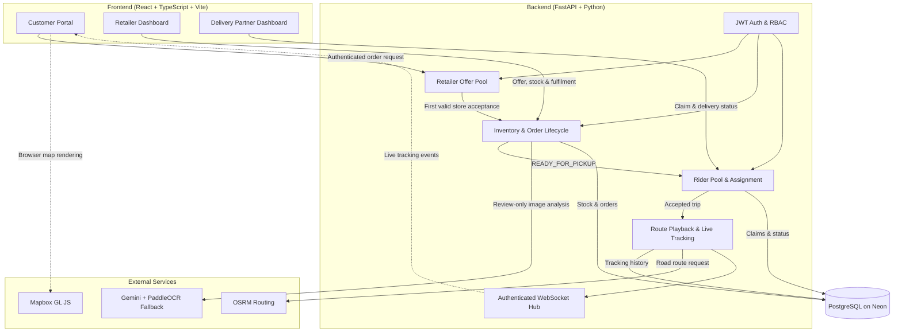
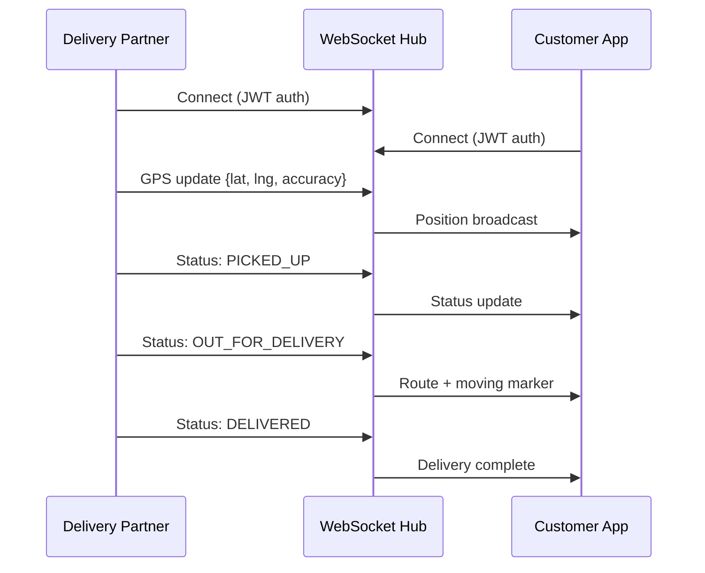

<div align="center">

# 🛒 Dukaan2Door

### Hyperlocal Direct Delivery Platform for Local Retailers

_From neighbourhood store to your doorstep — in minutes._

Customer ordering · Inventory-aware store matching · Retailer fulfillment  
Delivery partner self-claim · OSRM route planning · Real-time live tracking

[](backend/)
[](frontend/)
[](https://neon.tech/)
[](https://docs.mapbox.com/mapbox-gl-js/)
[](https://project-osrm.org/)
[](https://ai.google.dev/gemini-api/docs)
[](backend/alembic/)
[](#testing)
[](#real-time-tracking)

</div>

---

## Table of Contents

- [Overview](#overview)
- [Core Workflow](#core-workflow)
- [System Architecture](#system-architecture)
- [Technology Stack](#technology-stack)
- [Project Structure](#project-structure)
- [Features by Portal](#features-by-portal)
  - [Customer Portal](#-customer-portal)
  - [Retailer Portal](#-retailer-portal)
  - [Delivery Partner Portal](#-delivery-partner-portal)
- [Backend Services](#backend-services)
- [Real-Time Tracking](#real-time-tracking)
- [Data Architecture](#data-architecture)
- [Local Setup](#local-setup)
- [Environment Variables](#environment-variables)
- [Inventory Image Onboarding](#inventory-image-onboarding)
- [Demo Credentials & Walkthrough](#demo-credentials--walkthrough)
- [Testing](#testing)
- [Scripts](#scripts)
- [Deployment](#deployment)
- [Documentation](#documentation)

---

## Overview

**Dukaan2Door** is a hyperlocal grocery and essentials delivery platform that
connects customers with nearby local retailers. A customer selects products,
shares a delivery location, and places an order. The backend offers one order to
all stores in the active distance tier that can fill the complete cart; the
first valid retailer acceptance wins. Retailer and delivery-partner workflows
then move it through fulfillment to delivery, tracked on an interactive map.

The platform is designed around a **direct local-store experience** rather than
a large marketplace. Its public home routes customers, retailers, and delivery
partners to dedicated sign-in screens and protected role-specific portals.

### Key Highlights

- **Inventory-aware store matching** — 2 km radius, 5 km fallback
- **Complete order lifecycle** — from cart to delivered, with state-machine validation
- **Live delivery tracking** — WebSocket-driven GPS updates on Mapbox GL JS maps
- **AI-assisted inventory** — Gemini extraction, optional local PaddleOCR fallback, and mandatory retailer review
- **OSRM route planning** — real road-network routes with ETA estimation
- **Three full dashboards** — Customer, Retailer, and Delivery Partner
- **Role-specific access** — public home with separate customer, retailer, and rider sign-in flows
- **Auto-location detection** — HTML5 GPS → IP geolocation → Nominatim fallback chain

---

## Core Workflow

```
┌──────────────────────────────────────────────────────────────────┐
│  CUSTOMER                                                        │
│  📍 Location detection  →  🛍️ Browse & search products           │
│  🛒 Add to cart         →  💳 Checkout with delivery address      │
│  📦 Place order         →  📊 Track order status in real time     │
└──────────────┬───────────────────────────────────────────────────┘
               │
               ▼
┌──────────────────────────────────────────────────────────────────┐
│  BACKEND                                                         │
│  🏪 Find eligible stores (2km → 5km)  →  🔔 Create store offers  │
│  ✅ Validate complete cart              →  🔒 First claim wins   │
└──────────────┬───────────────────────────────────────────────────┘
               │
               ▼
┌──────────────────────────────────────────────────────────────────┐
│  RETAILER                                                        │
│  📋 View shared opportunity → ✅ Accept or reject                 │
│  🔒 Winner stock is deducted → 📦 Prepare and mark ready          │
│  📷 Analyze and review stock separately with Gemini AI           │
└──────────────┬───────────────────────────────────────────────────┘
               │
               ▼
┌──────────────────────────────────────────────────────────────────┐
│  DELIVERY PARTNER                                                │
│  📋 View nearby order    →  ✅ Atomically claim delivery         │
│  🏪 Pick up from store   →  🛵 Start delivery route              │
│  📍 Broadcast live GPS   →  ✅ Mark delivered                     │
└──────────────────────────────────────────────────────────────────┘
```

**Order Lifecycle State Machine:**

```
Order:    RECEIVED → ACCEPTED → PREPARING → READY_FOR_PICKUP
          → OUT_FOR_DELIVERY → DELIVERED
Delivery: ASSIGNED → ACCEPTED → PICKED_UP → OUT_FOR_DELIVERY → DELIVERED
```

---

## System Architecture



Explore the full runtime view in the
[interactive Dukaan2Door architecture diagram](docs/dukaan2door-architecture.html).

---

## Technology Stack

<div align="center">

### Experience Layer

[](https://react.dev/)
[](https://www.typescriptlang.org/)
[](https://vite.dev/)
[](https://tailwindcss.com/)
[](https://docs.mapbox.com/mapbox-gl-js/)

### Application Layer

[](https://www.python.org/)
[](https://fastapi.tiangolo.com/)
[](https://docs.pydantic.dev/)
[](https://developer.mozilla.org/en-US/docs/Web/API/WebSockets_API)
[](https://ai.google.dev/gemini-api/docs)

### Data & Infrastructure

[](https://www.postgresql.org/)
[](https://neon.tech/)
[](https://www.sqlalchemy.org/)
[](https://alembic.sqlalchemy.org/)
[](https://project-osrm.org/)
[](https://render.com/)

</div>

<details>
<summary><strong>View stack responsibilities</strong></summary>

| Layer | Current Stack |
|---|---|
| **Web application** | [React 18](https://react.dev/) · TypeScript · [Vite](https://vite.dev/) |
| **Interface** | [Tailwind CSS](https://tailwindcss.com/) · Lucide icons · responsive role-based layouts |
| **Client state** | React Context API · local cart persistence |
| **Backend API** | Python 3.11 · [FastAPI](https://fastapi.tiangolo.com/) · Pydantic v2 |
| **Authentication** | JWT · bcrypt · role and resource-level authorization |
| **Database** | PostgreSQL on [Neon](https://neon.tech/) · SQLAlchemy · Alembic |
| **Maps** | [Mapbox GL JS](https://docs.mapbox.com/mapbox-gl-js/) · GeoJSON route layers · browser GPS |
| **Routing** | [OSRM](https://project-osrm.org/) road geometry, distance, and ETA |
| **Inventory AI** | [Gemini](https://ai.google.dev/gemini-api/docs) primary · PaddleOCR optional CPU fallback |
| **Geocoding** | Nominatim reverse geocoding · ipwho.is IP fallback |
| **Real-time** | Authenticated FastAPI WebSockets · persisted tracking recovery |
| **Deployment** | Render API · Neon PostgreSQL · static frontend hosting |

</details>

---

## Project Structure

```
Dukaan2Door/
├── backend/
│   ├── alembic/                    # Database migrations
│   ├── app/
│   │   ├── api/v1/endpoints/       # REST API endpoints
│   │   │   ├── auth.py             # Login, registration, current user
│   │   │   ├── orders.py           # Order CRUD, status tracking
│   │   │   ├── deliveries.py       # Delivery assignment & tracking
│   │   │   ├── products.py         # Product catalog & inventory
│   │   │   ├── inventory.py        # OCR analysis, review confirmation, history
│   │   │   ├── retailers.py        # Store management
│   │   │   ├── customers.py        # Customer profiles
│   │   │   ├── delivery_partners.py # Partner profiles & availability
│   │   │   ├── matching.py         # Store matching endpoint
│   │   │   ├── uploads.py          # File uploads
│   │   │   └── websocket.py        # WebSocket connections
│   │   ├── core/                   # Config, security, dependencies
│   │   ├── models/                 # SQLAlchemy ORM models
│   │   ├── schemas/                # Pydantic request/response schemas
│   │   ├── services/               # Business logic layer
│   │   │   ├── auth_service.py
│   │   │   ├── order_service.py
│   │   │   ├── delivery_service.py
│   │   │   ├── store_matching_service.py
│   │   │   ├── routing_service.py
│   │   │   ├── geo_service.py
│   │   │   ├── product_service.py
│   │   │   ├── ocr_service.py
│   │   │   ├── inventory_image_analyzer.py
│   │   │   ├── gemini_inventory_analyzer.py
│   │   │   ├── inventory_parser.py
│   │   │   └── realtime_service.py
│   │   └── main.py                 # FastAPI app entry
│   ├── tests/                      # Pytest unit and integration suite
│   └── requirements.txt
├── frontend/
│   ├── src/
│   │   ├── components/
│   │   │   ├── customer/           # ProductCard, CartItem, OrderTimeline, LocationModal...
│   │   │   ├── retailer/           # OrderCard, OrderDetailModal, ProductModal, StoreToggle...
│   │   │   ├── delivery/           # ActiveDeliveryCard, StatusControls, LocationTracker...
│   │   │   ├── maps/               # MapView, DeliveryMap, StoreLocationPicker, RadiusMap
│   │   │   ├── layout/             # Shared layout components
│   │   │   └── ui/                 # Reusable UI primitives
│   │   ├── pages/
│   │   │   ├── auth/               # Login gateway, role-specific login, registration
│   │   │   ├── public/             # General project home and role entry points
│   │   │   ├── customer/           # 17 pages (Home, Cart, Checkout, Tracking, Orders...)
│   │   │   ├── retailer/           # 10 pages (Dashboard, Orders, Inventory, Store...)
│   │   │   └── delivery/           # 7 pages (Dashboard, Available, Current, Earnings...)
│   │   ├── services/               # API client and service layer
│   │   ├── context/                # Auth & Cart context providers
│   │   ├── types/                  # TypeScript interfaces
│   │   └── App.tsx                 # Router with role-based routing
│   └── package.json
├── scripts/                        # Seeding, ingestion, and E2E story scripts
├── data/                           # Dataset assets and staging
├── docs/                           # Architecture and testing documentation
└── README.md
```

---

## Features by Portal

### 🛍️ Customer Portal

| Feature | Description |
|---|---|
| **Location Detection** | Auto-detect via HTML5 GPS → IP geolocation → manual address entry |
| **Interactive Map** | Mapbox GL JS location selection with responsive controls and markers |
| **Product Browsing** | Category filtering, search, availability badges |
| **Store Discovery** | View nearby stores on map with radius overlay |
| **Cart Management** | Add/remove items, quantity selector, running total |
| **Checkout** | Delivery address confirmation, order placement |
| **Order Tracking** | Real-time status timeline with step-by-step progress |
| **Live Map Tracking** | Watch delivery partner move on map in real time |
| **Order History** | Past orders with detail view and status |
| **Profile Management** | Update name, phone, delivery address |

**Customer Pages:** `HomePage`, `LocationPage`, `StorePage`, `ProductListingPage`, `ProductDetailPage`, `SearchPage`, `CartPage`, `CheckoutPage`, `OrderConfirmationPage`, `OrderStatusPage`, `OrderDetailPage`, `OrderHistoryPage`, `LiveTrackingPage`, `ProfilePage`, `NotificationsPage`, `HelpSupportPage`, `RegisterPage`

---

### 🏪 Retailer Portal

| Feature | Description |
|---|---|
| **Dashboard** | Order overview with status filters and quick actions |
| **Order Management** | Accept, prepare, and mark orders ready for pickup |
| **Delivery Dispatch** | Make ready orders available to eligible nearby delivery partners |
| **Inventory Management** | Scan bills/lists, identify product packaging, review catalog matches, and confirm audited add/reduce adjustments |
| **Store Settings** | Business hours, store status toggle (open/closed) |
| **Performance Analytics** | Order volume, revenue, and fulfillment metrics |
| **Store Overview** | Map-based store location with delivery radius visualization |

**Retailer Pages:** `RetailerHomePage`, `RetailerDashboard`, `RetailerOrdersPage`, `RetailerInventoryPage`, `RetailerStorePage`, `RetailerStoreOverviewPage`, `RetailerMenuPage`, `RetailerPerformancePage`, `RetailerBusinessSettingsPage`, `RetailerHelpPage`

---

### 🚴 Delivery Partner Portal

| Feature | Description |
|---|---|
| **Dashboard** | Active delivery with status controls, earnings summary |
| **Available Orders** | Review, decline, or exclusively claim orders ready for pickup |
| **Active Delivery** | Step-by-step delivery flow with map and route |
| **GPS Broadcasting** | Browser GPS or road-based demo updates broadcast to the customer via WebSocket |
| **Status Progression** | Accept → Pick Up → Out for Delivery → Delivered |
| **Earnings Tracker** | Delivery history with earnings breakdown |
| **Profile** | Availability toggle, vehicle info, contact details |

**Delivery Pages:** `DeliveryHomePage`, `DeliveryDashboard`, `AvailableOrdersPage`, `CurrentDeliveryPage`, `DeliveryHistoryPage`, `DeliveryEarningsPage`, `DeliveryProfilePage`

---

## Backend Services

| Service | File | Responsibility |
|---|---|---|
| **Auth** | `auth_service.py` | JWT token generation, password hashing, user validation |
| **Store Matching** | `store_matching_service.py` | 2 km/5 km radius search, inventory-aware store selection |
| **Orders** | `order_service.py` | Order creation, status transitions, ownership validation |
| **Delivery** | `delivery_service.py` | Eligible-order discovery, atomic rider claims/rejections, delivery state machine |
| **Routing** | `routing_service.py` | OSRM integration for road-network routes, distance, and ETA |
| **Geo** | `geo_service.py` | Haversine distance calculation, coordinate validation |
| **Products** | `product_service.py` | Catalog queries, category filtering, inventory checks |
| **Inventory analysis** | `inventory_image_analyzer.py`, `gemini_inventory_analyzer.py`, `ocr_service.py` | Gemini structured extraction, optional local PaddleOCR fallback, and review-only drafts |
| **Realtime** | `realtime_service.py` | WebSocket connection manager, event broadcasting |

### API Endpoints

| Group | Base Path | Key Operations |
|---|---|---|
| **Auth** | `/api/auth` | Register, login, current user |
| **Orders** | `/api/orders` | Create, list, status update, tracking, store details |
| **Deliveries** | `/api/deliveries` | Claim/decline/reject, accept, pickup, deliver, route, GPS tracking |
| **Products** | `/api/products` | Browse catalog, search, category filter, inventory |
| **Retailers** | `/api/retailers` | Store profile, products, status toggle |
| **Inventory** | `/api/retailer/inventory` | Analyze bills/product photos, confirm reviewed stock, add/reduce, manual entry, history |
| **Customers** | `/api/customers` | Profile, address, location |
| **Partners** | `/api/delivery-partners` | Profile, availability, location update |
| **Matching** | `/api/matching` | Find eligible store for coordinates + items |
| **WebSocket** | `/api/ws/deliveries/{delivery_id}` | Authorized delivery GPS and status events |

Full interactive API docs available at `http://localhost:8080/docs` when the backend is running.

---

## Real-Time Tracking

The delivery tracking system uses **authenticated WebSockets** for live updates:

1. After acceptance, the backend starts the rider-to-store leg on OSRM road geometry.
2. The trip continues independently of the rider's active browser tab.
3. At the store, pickup verification opens after a two-minute dwell.
4. Marking the order picked up automatically starts the store-to-customer leg.
5. The backend persists route points and broadcasts them to rider and customer maps.
6. Delivery completion remains a deliberate rider action after arrival.

For real operations, route playback can remain disabled and the rider can share
browser GPS. The controlled walkthrough uses source `ROUTE_PLAYBACK`; both modes
use the same authenticated tracking, Mapbox rendering, and WebSocket pipeline.



---

## Data Architecture

### Operational Tables

| Table | Purpose |
|---|---|
| `users` | All user accounts with role (customer/retailer/delivery_partner) |
| `customers` | Customer profiles, delivery address, coordinates |
| `retailers` | Retailer profiles linked to stores |
| `stores` | Store name, location, coordinates, opening status |
| `products` | Product catalog (name, category, price, image) |
| `inventory` | Per-store stock levels for each product |
| `inventory_adjustments` | Auditable stock increases, manual changes, and order reductions |
| `orders` | Orders with status, customer, store, and delivery references |
| `order_items` | Line items with product, quantity, and price |
| `delivery_partners` | Partner profiles, vehicle info, availability, coordinates |
| `deliveries` | Delivery records linking orders to partners |
| `delivery_tracking` | GPS or server route-playback breadcrumb trail with source, timestamp, status, and accuracy |
| `delivery_rejections` | Rider rejection history without cancelling the customer order |
| `retailer_order_offers` | Store-specific pending/accepted/rejected/expired opportunities for one customer order |
| `retailer_order_offer_items` | Exact product and inventory mapping used to revalidate each store offer |

The current non-destructive Alembic head is `20261017_0009`.

### Data Ingestion Pipeline

```
External Datasets → Raw Files → Staging Tables → Normalization → Application Tables
```

Source provenance is preserved. The system does not fabricate customer
identities, store coordinates, or operational relationships from external
datasets that don't contain them.

---

## Local Setup

### Prerequisites

- Python 3.11 recommended (required for the optional tested PaddleOCR fallback)
- Node.js 18+
- PostgreSQL (or a [Neon](https://neon.tech/) database URL)

### Backend

```bash
cd backend
python3.11 -m venv .venv
source .venv/bin/activate        # Linux/macOS
# .\.venv\Scripts\Activate.ps1   # Windows PowerShell
pip install --upgrade pip
pip install -r requirements.txt
cp .env.example .env             # First setup only; then add DATABASE_URL and secrets
python -m alembic upgrade head
uvicorn app.main:app --reload --port 8080
```

Inventory analysis uses Gemini when `GEMINI_API_KEY` is configured. The base
requirements do not install the much larger Paddle runtime. To enable the
optional local provider tested by this repository, use Python 3.11 and install
`paddleocr==3.7.0` with `paddlepaddle==3.3.1`. If neither provider succeeds,
manual entry remains available. Paddle models load lazily and are reused per
process.

### Backend with Docker or Podman

Stop any existing process on port `8080`, then run these commands from
`backend/`. Replace `podman` with `docker` if preferred.

```bash
podman build -t dukaan2door-backend .
podman run --rm --env-file .env dukaan2door-backend \
  python -m alembic upgrade head
podman run --rm --name dukaan2door-api --env-file .env \
  -p 8080:8080 dukaan2door-backend
```

For a local PostgreSQL server, make sure the container can reach the database
host. A Neon `DATABASE_URL` works directly through the supplied environment.

### Frontend

In a second terminal:

```bash
cd frontend
npm install
cp .env.example .env             # Set VITE_MAPBOX_TOKEN if using Mapbox tiles
npm run dev
```

Production verification and preview:

```bash
npm run build                     # TypeScript check + Vite production build
npm run preview -- --host 0.0.0.0
```

### Access Points

| Service | URL |
|---|---|
| Frontend | http://localhost:3000 |
| API Docs (Swagger) | http://localhost:8080/docs |
| Health Check | http://localhost:8080/health |

> ⚠️ Never commit `.env` files or production credentials.

---

## Environment Variables

### Backend (`backend/.env`)

| Variable | Description | Required |
|---|---|---|
| `DATABASE_URL` | PostgreSQL connection string (Neon or local) | ✅ |
| `JWT_SECRET_KEY` | Secret for JWT token signing | ✅ |
| `ALGORITHM` | JWT algorithm (default: `HS256`) | ✅ |
| `ACCESS_TOKEN_EXPIRE_MINUTES` | Token expiry in minutes | ✅ |
| `CORS_ORIGINS` | Comma-separated allowed origins | ✅ |
| `OSRM_BASE_URL` | OSRM server URL for routing | ✅ |
| `ENABLE_ROUTE_PLAYBACK` | Run browser-independent OSRM route movement for a controlled walkthrough | Optional |
| `ROUTE_PLAYBACK_SPEED_KMH` | Baseline route speed (default: `40`) | Optional |
| `ROUTE_PLAYBACK_UPDATE_SECONDS` | Persisted tracking interval (default: `2.5`) | Optional |
| `PICKUP_DWELL_SECONDS` | Deprecated compatibility setting; pickup confirmation is enabled once the rider reaches the store | Optional |
| `GEMINI_API_KEY` | Server-only Gemini key for inventory document analysis | Required for Gemini |
| `GEMINI_MODEL` | Gemini model ID (default: `gemini-2.5-flash-lite`) | Optional |
| `PADDLE_OCR_DETECTION_MODEL` | Detection model (default: `PP-OCRv6_small_det`) | Optional |
| `PADDLE_OCR_RECOGNITION_MODEL` | Recognition model (default: `PP-OCRv6_medium_rec`) | Optional |
| `PADDLE_OCR_CPU_THREADS` | CPU inference threads per backend process (default: `4`) | Optional |
| `PADDLE_OCR_MAX_IMAGE_SIDE` | Maximum image dimension before resizing (default: `1600`) | Optional |
| `PADDLE_OCR_MAX_IMAGE_PIXELS` | Reject decompressed images above this pixel count (default: `25000000`) | Optional |
| `PADDLE_OCR_MAX_PDF_PAGES` | Maximum accepted PDF pages (default: `10`) | Optional |
| `PADDLE_OCR_LOW_CONFIDENCE` | Review-warning threshold (default: `0.70`) | Optional |
| `PADDLE_OCR_COMPARE_PREPROCESSED` | Compare original and mildly enhanced image results (default: `false`) | Optional |
| `PADDLE_OCR_USE_ORIENTATION` | Enable Paddle document/text-line orientation models (default: `false`) | Optional |

### Inventory Image Onboarding

Inventory image analysis uses the Gemini API for structured product extraction.
The key remains server-side. When the optional Paddle packages are installed,
the provider-neutral analyzer can fall back to local
[PaddleOCR](https://github.com/PaddlePaddle/PaddleOCR) for quota and transient
provider errors. Neither path writes inventory directly.

Retailers can open **Inventory** and select **Add Inventory**. The modal keeps
three explicit workflows: upload a bill/stock list, scan one or more product
packages, or adjust an existing product without an image. Manual product entry
remains available.

A JPG, PNG, WEBP, or PDF bill/list (maximum 5 MB) is processed by Gemini; the
optional Paddle provider supports JPG, PNG, and PDF. Product-photo analysis
accepts JPG, PNG, or WEBP and returns packaging evidence plus deterministic
store-catalog candidates. A single visible package is never treated as the
stock quantity, and printed MRP is not treated as the selling price.

```text
Retailer upload
  -> FastAPI validation and preprocessing
  -> Gemini structured extraction
  -> optional local PaddleOCR/parser fallback when available
  -> provider-neutral product candidates
  -> mandatory retailer review
  -> confirmed inventory transaction
```

```text
Product photo
  -> packaging evidence and catalog candidates
  -> exact retailer-selected product and pack size
  -> explicit Add or Reduce direction, quantity, and reason
  -> current-stock and expected-stock preview
  -> idempotent locked adjustment transaction and audit record
```

The backend validates the MIME type, extension, file size, image integrity,
dimensions, and PDF page count first. The local provider applies EXIF
orientation and bounded resizing; optional preprocessing comparison adds
conservative grayscale, contrast, and sharpening. Its model is initialized
lazily once per backend process and guarded for thread-safe inference.
Handwriting remains best effort; low-confidence or incomplete rows are
highlighted for review.

Confirmed stock is store-specific. Bill/list confirmation may use the authorized
product-creation path. Product-photo adjustments require an existing catalog
match and cannot create products. Additions, reductions, legacy quantity edits,
manual/image-assisted increases, and order decrements are recorded in inventory
adjustment history; retailer-authored changes include the authorized user.

### Measured local fallback profile

A Paddle-enabled Python 3.11 CPU image was tested locally with the selected
model configuration and one generated clean receipt:

| Measurement | Result |
|---|---|
| Docker build (cold package/model download) | 5m 36s |
| Final image size, including models | 1.89 GB |
| Cached model files | 97 MiB |
| Process RSS after repeated OCR | 733 MiB |
| Cached-process first OCR | 13.1s |
| Warm second OCR | 10.8s |
| Offline OCR from embedded models | 7.5s |
| Generated receipt extraction | 3/3 product names, quantities, and prices |

This measures the PaddleOCR fallback, not Gemini latency or accuracy. It is a
small deployment smoke test, not a general accuracy claim. No
representative real kirana bill or handwriting benchmark images are committed
to this repository, so real-bill and neat/poor-handwriting accuracy remains
unmeasured. Add private samples to the ignored benchmark directory and run the
benchmark tool before making those claims.

To verify the tools with the committed benchmark fixture from the repository
root, run:

```bash
source backend/.venv/bin/activate
python scripts/test_paddle_ocr.py benchmarks/inventory_ocr/images/01_clean_receipt.png
python scripts/test_gemini_inventory.py benchmarks/inventory_ocr/images/01_clean_receipt.png
python scripts/benchmark_gemini_inventory.py benchmarks/inventory_ocr/manifest.json
```

Replace the sample image path with an actual sanitized bill only after adding
that file locally. The benchmark command requires the JSON manifest file, not
the `benchmarks/` directory. Gemini commands also require `GEMINI_API_KEY` in
the backend environment; PaddleOCR requires its optional local packages.

### Frontend (`frontend/.env`)

| Variable | Description | Required |
|---|---|---|
| `VITE_API_URL` | Backend API base URL | ✅ |
| `VITE_WS_URL` | Backend WebSocket base URL | ✅ |
| `VITE_MAPBOX_TOKEN` | Mapbox public token for map tiles | Optional |
| `VITE_CUSTOMER_STORE_ID` | Operational store ID exposed in the single-store customer catalog | ✅ |
| `VITE_ENABLE_ROUTE_PLAYBACK` | Use backend-owned route tracking instead of browser GPS | Optional |

---

## Demo Credentials & Walkthrough

### Quick-Start Accounts

| Portal | Email | Password |
|---|---|---|
| 🛍️ Customer | `rahul@example.com` | `DemoPassword123!` |
| 🏪 Retailer | `satellite.retailer.rahul@example.com` | `DemoPassword123!` |
| 🏪 Retailer | `satellite.retailer.neha@example.com` | `DemoPassword123!` |
| 🏪 Retailer | `satellite.retailer.priya@example.com` | `DemoPassword123!` |
| 🚴 Delivery Partner | `satellite.rider.rahul@example.com` | `DemoPassword123!` |
| 🚴 Delivery Partner | `satellite.rider.arjun.3km@example.com` | `DemoPassword123!` |
| 🚴 Delivery Partner | `satellite.rider.meera@example.com` | `DemoPassword123!` |

### End-to-End Demo Flow

```
1. Customer logs in → browses products → adds to cart → checks out
2. Three eligible retailers see the same shared request → first acceptance wins
3. Winning retailer prepares the order → marks ready for pickup
4. Three eligible delivery partners see the same ready order → first claim wins
5. Partner starts route → marks Out for Delivery → GPS tracking begins
6. Customer watches live map with moving delivery marker
7. Partner arrives → marks Delivered → order complete ✅
```

### Seed Demo Data

```bash
python scripts/seed_dashboard_accounts.py --allow-remote
python scripts/seed_satellite_catalog.py --allow-remote --restock
```

`--restock` only resets inventory in the three allowlisted Satellite demo
stores. Use separate browser profiles for the three retailer and three rider
accounts to demonstrate both shared pools and the first-accept conflict.

See the [Complete Demo Story](docs/demo/dukaan2door-story-testing-guide.md) for
the credential table and step-by-step browser walkthrough.

---

## Testing

### Backend Unit & Integration Tests

```bash
cd backend
python -m pytest -q
```

**Current verified result:** `122 passed, 1 PostgreSQL-only test skipped`; the
PostgreSQL race test passed separately against a disposable PostgreSQL 16 database.

Test coverage includes:
- API endpoint validation
- Order state machine transitions
- Authentication and authorization
- Backend integration workflows
- Security checks
- Gemini extraction/error handling and PaddleOCR fallback parsing
- Product-photo catalog matching and review-only analysis
- Inventory add/reduce safety, audit history, and idempotent confirmation
- Rider claim locking, offer decline/rejection, and special-equipment eligibility

### OCR-Specific Tests

These tests mock provider inference and do not download models:

```bash
cd backend
python -m pytest tests/test_inventory_ocr.py -q
```

**Result:** `17 passed`

Gemini-focused validation:

```bash
cd backend
python -m pytest tests/test_gemini_inventory_analyzer.py -q
```

**Result:** `23 passed`

### Frontend Validation

Run the focused frontend regression suite and production build:

```bash
cd frontend
npm test
npm run build
```

**Current verified result:** `23 passed`; TypeScript and Vite build passed.

### Compile Check

```bash
python -m compileall -q backend/app backend/tests scripts
```

### End-to-End API Story

Run while the backend is serving:

```bash
python scripts/run_story.py
```

Creates isolated accounts, products, inventory, orders — walks the complete
retailer and delivery lifecycle, sends tracking updates, and verifies role
visibility. Refuses non-local URLs unless `--allow-remote` is supplied.

---

## Scripts

| Script | Purpose |
|---|---|
| `seed_dashboard_accounts.py` | Create demo customer, retailer, and delivery partner accounts |
| `seed_satellite_catalog.py` | Populate the demo store with products and inventory |
| `seed_operational_demo.py` | Full operational demo setup |
| `run_story.py` | Automated E2E API story (order lifecycle test) |
| `ingest_all.py` | Full data ingestion pipeline |
| `import_bigbasket_to_store.py` | Import BigBasket dataset into store catalog |
| `import_blinkit_to_store.py` | Import Blinkit dataset into store catalog |
| `clean_bigbasket_kirana.py` | Clean and normalize BigBasket kirana data |
| `profile_datasets.py` | Profile and analyze dataset quality |
| `verify_neon_demo_workflow.py` | Verify Neon database demo readiness |
| `verify_blinkit_integration.py` | Validate Blinkit data integration |
| `test_paddle_ocr.py` | Optional local PaddleOCR extraction with text, confidence, polygons, drafts, and timing |
| `test_gemini_inventory.py` | One-image Gemini extraction and structured-candidate inspection |
| `benchmark_paddle_ocr.py` | Manifest-driven local PaddleOCR accuracy and latency benchmark |
| `benchmark_gemini_inventory.py` | Manifest-driven Gemini field-accuracy, missing/extra-row, failure, and latency benchmark |
| `verify_postgres_inventory.py` | Isolated PostgreSQL migration, replay, ownership, and rollback verifier |

---

## Deployment

The backend is a standard FastAPI application designed for **Render** deployment
with a **Neon PostgreSQL** database.

### Production Start Command

```bash
uvicorn app.main:app --host 0.0.0.0 --port $PORT
```

Render supplies `PORT` at runtime. Follow
[the Neon migration runbook](docs/neon-migration-runbook.md) before deployment.
Configure `GEMINI_API_KEY` only in the backend service. The Python 3.11 image
uses the base requirements and does not install PaddleOCR unless the deployment
is deliberately extended with the optional CPU packages.

### Architecture Notes

- WebSocket broadcasting uses **in-memory connection management** — suitable for
  a single service instance
- Multi-instance deployment would require shared pub/sub infrastructure
  (e.g., Redis)
- Database connections use SQLAlchemy with the PostgreSQL `psycopg2` driver
- Optional local OCR is CPU and memory intensive; use a single worker until
  measured resources justify more because each process owns a model instance
- The measured Paddle-enabled Python 3.11 image was 1.89 GB, its cached models
  occupied 97 MiB, and repeated local OCR reached 733 MiB RSS
- A Paddle-enabled deployment needs at least 1 GiB RAM; 2 GiB is preferred for
  operational headroom. These limits do not describe the standard Gemini-only
  image
- Paddle-enabled builds must use a compatible Python version and should cache
  model files rather than downloading them during the first production request
- Frontend can be deployed as a static build (`npm run build`) to any CDN

---

## Documentation

| Document | Description |
|---|---|
| 📚 [Documentation Hub](docs/README.md) | Central index and navigation hub for all project documentation |
| 🗺️ [Interactive Runtime Architecture](docs/dukaan2door-architecture.html) | Current frontend, backend, database, external services, trust boundaries, and primary runtime path |
| 🚀 [Deployment Guide](docs/deployment-guide.md) | Production setup for Render, Neon, Vercel, and OSRM |
| 🎬 [Complete Demo Story](docs/demo/dukaan2door-story-testing-guide.md) | Setup, user stories, pooling matrix, and faculty presentation script |
| 🏪 [Multi-Retailer Testing](docs/demo/multi-retailer-testing-guide.md) | Three-vendor fan-out, first acceptance, stock, and isolation checks |
| 🚴 [Multi-Rider Testing](docs/demo/multi-rider-testing-guide.md) | Three-rider fan-out, first claim, eligibility, and tracking checks |
| 🧭 [Neon Migration Runbook](docs/neon-migration-runbook.md) | Controlled migration, verification, and recovery steps |
| 🤖 [Gemini Demo Readiness](docs/gemini-demo-readiness.md) | Quota, fallback, privacy, and pre-demo checks |
| 📍 [Live Tracking Validation](docs/live-tracking-validation.md) | Two-device real-GPS acceptance procedure |
| ✅ [Complete Workflow Audit](docs/audits/dukaan2door-complete-workflow-audit.md) | Evidence-based order, retailer, rider, inventory, tracking, and readiness audit |
| 🧾 [API Verification Matrix](docs/audits/api-verification-matrix.md) | Actual endpoint inventory, authorization, data ownership, and test status |
| 🗄️ [Database Integrity Report](docs/audits/database-integrity-report.md) | Migration, row-lock, idempotency, and inventory transaction verification |
| 📡 [Rider Tracking Verification](docs/audits/rider-tracking-verification.md) | GPS, OSRM, Mapbox, WebSocket snapshot, and demo-mode evidence |
| 🎓 [Faculty Demo Checklist](docs/audits/faculty-demo-checklist.md) | Reproducible three-role demonstration and failure checklist |
| 📊 [Data Ingestion Pipeline](docs/data-ingestion.md) | External dataset staging, provenance, and data cleaning |
| 💼 [Business Model](docs/business-model.md) | Commercial hypotheses, unit economics, canvas, and validation plan |
| ✅ [Faculty Feedback Resolution](docs/faculty-feedback-resolution.md) | Evidence and limitations for all eight faculty comments |
| 📝 [IDT-I Project Report Draft](docs/report/IDT-I-Dukaan2Door-Report.md) | Editable report aligned with the supplied IDT-I format |
| 📝 [Survey Package](docs/survey/survey-methodology.md) | Consent-ready questionnaires, collection method, templates, and analysis workflow |

---

<div align="center">

**Built with ❤️ for local retailers and their communities**

[FastAPI](https://fastapi.tiangolo.com/) · [React](https://react.dev/) · [Neon](https://neon.tech/) · [Mapbox](https://www.mapbox.com/) · [OSRM](https://project-osrm.org/) · [Gemini](https://ai.google.dev/gemini-api/docs)

</div>
